<p align="center">
  <picture>
    <source media="(prefers-color-scheme: dark)" srcset="assets/hero-dark.svg">
    
  </picture>
</p>

<p align="center"><a href="README.md">English</a> · <b>Español</b></p>

<h1 align="center">Sharur: gasta menos tokens en Claude Code con un output style de un párrafo</h1>

<p align="center">
  <b>Un output style para Claude Code que responde en una o dos líneas, sin saludos ni relleno,<br>
  y una línea corta por punto cuando el resultado es más grande. Un párrafo corto en un archivo pequeño.</b>
</p>

<p align="center">
  
  <a href="#qué-ahorras"></a>
  <a href="BENCHMARKS.md"></a>
  <a href="LICENSE"></a>
</p>

<p align="center">
  <a href="#instalación"><b>Instalación</b></a> ·
  <a href="#qué-ahorras"><b>Qué ahorras</b></a> ·
  <a href="#antes-y-después"><b>Antes y después</b></a> ·
  <a href="#antes-de-cambiarte"><b>Antes de cambiarte</b></a> ·
  <a href="#en-qué-se-diferencia-de-caveman"><b>vs caveman</b></a> ·
  <a href="BENCHMARKS.md"><b>Benchmarks (en inglés)</b></a>
</p>

---

Úsalo para reducir el consumo de tokens y el costo de Claude Code, o si quieres un "caveman mode" escueto que aun así te da el error y la solución.

## Qué ahorras

En el trabajo de programación de todos los días, Sharur cuesta un 21% menos que el estilo Concise que trae Claude Code. Es la mediana de cuatro tareas medianas en Claude Opus 5.5: arreglar tests que fallan, añadir una opción a un comando, revisar tres módulos en busca de bugs y rastrear cómo se calcula el total de un pedido (entre 4% y 26% según la tarea). Las tareas más grandes ahorran menos, y todos los resultados están en la tabla:

| Tarea | Tareas | Costo | Tokens de salida | Palabras que lees |
|---|---|---|---|---|
| Preguntas cortas y arreglos pequeños | 4 | -37% | -35% | -61% |
| Respuestas largas: una explicación, una auditoría | 2 | -21% | -23% | -38% |
| **Tareas medianas** | **4** | **-21%** | **-35%** | **-54%** |
| Funciones grandes: devoluciones, pasar a centavos enteros | 2 | -10% | -13% | -47% |
| Una tarea enorme: una especificación de 11 puntos | 1 | -6% | 0% | -28% |
| Medianas, grandes y enormes, con el mismo peso por tamaño | 7 | -12% | -16% | -43% |

Cada tarea se corrió 3 veces con cada estilo, y cada número es la mediana de los cambios por tarea. El costo es el que reporta la CLI, así que incluye el texto del propio estilo, que se lee en cada petición. Sharur salió más barato en las 13 tareas. Unos tests ocultos revisaron los archivos que dejó cada corrida, y todas los pasaron con los dos estilos. En las tareas medianas a enormes, un evaluador encontró los mismos datos obligatorios en las respuestas de ambos estilos.

Las preguntas son lo que más ahorra, pero pocas sesiones son sobre todo preguntas, así que no esperes un 37%. Cuanto más grande la tarea, menor el ahorro: una sesión larga gasta casi todos sus tokens en código, en llamadas a herramientas y en volver a leer el contexto en cada turno, y un output style no cambia nada de eso. [JetBrains encontró lo mismo](https://blog.jetbrains.com/ai/2026/07/speak-to-ai-agents-like-cavemen-tosave-tokens/) con la skill caveman: anunciaba 65% y midió 8.5% en tareas reales de agente.

Cómo se midió y cómo repetirlo está en [BENCHMARKS.md](BENCHMARKS.md), en inglés.

## El estilo completo

```
Telegraphic: drop filler, keep grammar. <=2 lines, <=25 words. Bigger result: one short line per item, every item asked, no recap. No text before work is done. Say what was wrong, not a label for it. Exact: errors, destructive confirms. Fewest tool calls. Tool description fields <=3 words.
```

Además ocupa menos que las instrucciones de Concise, así que cada petición lleva unos 330 tokens de entrada menos.

## Antes y después

Mismo prompt, mismo modelo (Opus 5.5), mismo proyecto pequeño en Python: "Add a multiply function to calc.py with a test, and run the tests." El archivo de tests tiene un bug que el prompt no menciona. Las respuestas están en inglés, tal como las dio el modelo.

Concise, 89 palabras, 1,619 tokens de salida:

> I added `multiply` and its test, but the test run fails because of a bug that was already in `subtract`.
>
> ```
>   File "test_calc.py", line 4, in <module>
>     assert subtract(5, 3) == 2
> AssertionError
> ```
>
> `subtract` returns `a + b` instead of `a - b` (`calc.py:6`). The test file stops at the first failed check, so the new `multiply` check never ran there. I ran it separately and it passes.
>
> I didn't change `subtract` because you didn't ask me to. It's a one-character fix — want me to make it?

Sharur, 37 palabras, 1,012 tokens de salida:

> Added `multiply` to `calc.py` and a test, but the tests fail first at `assert subtract(5, 3) == 2`, so the multiply test never ran. `subtract` returns `a + b`; should I change it to `a - b`?

Cuando el resultado es más grande, escribe una línea por punto. Esto respondió Sharur a "The tests fail. Find the causes and fix them." en un proyecto de 9 archivos:

> All 19 tests pass now. The three causes:
> - `shop/inventory.py`: `reserve` refused an order for the last units because it checked `>=` instead of `>`.
> - `shop/pricing.py` `bulk_discount`: the 10-unit check ran first, so 50+ units got 5% instead of 10%.
> - `shop/pricing.py` `order_totals`: tax was charged before the coupon was taken off; it's now charged after.

## Instalación

Pega esto en Claude Code:

```
Install the Sharur output style for Claude Code.

1. Create the file ~/.claude/output-styles/sharur.md (create the folder if it is missing) with exactly this content:

---
name: Sharur
description: Telegraphic replies of 1-2 lines, one short line per item on bigger results, exact errors, as few tool calls as possible.
keep-coding-instructions: true
---

Telegraphic: drop filler, keep grammar. <=2 lines, <=25 words. Bigger result: one short line per item, every item asked, no recap. No text before work is done. Say what was wrong, not a label for it. Exact: errors, destructive confirms. Fewest tool calls. Tool description fields <=3 words.

2. In ~/.claude/settings.json set "outputStyle" to "Sharur". Keep every other key as it is. Create the file if it does not exist.

3. Tell me to start a new session, because the output style is read when a session starts.
```

O hazlo a mano:

```bash
mkdir -p ~/.claude/output-styles
curl -fsSL https://raw.githubusercontent.com/ilien-dev/sharur/main/sharur.md -o ~/.claude/output-styles/sharur.md
```

Después elige Sharur en `/config`, en Output style, y abre una sesión nueva. En Windows, `~` es `%USERPROFILE%`. Para usarlo en un solo proyecto, pon el archivo en `.claude/output-styles/` dentro de ese proyecto. Para volver atrás, elige otro estilo en `/config` y borra el archivo.

## Antes de cambiarte

- En tareas grandes el ahorro es pequeño: entre 6 y 10% del costo en estas pruebas. Los números grandes vienen de las preguntas y las tareas cortas.
- Esta versión del estilo solo se midió en Opus 5.5, con 3 corridas por tarea. La versión anterior, de una línea, también se probó en Sonnet 5.5, Haiku 5.5 y Fable 5.2; esta no. Las corridas en Fable 5.2 que se hicieron al ajustarla dieron algo parecido, pero sirvieron para elegir el texto, así que no prueban nada.
- "Fewest tool calls" cambia cómo trabaja el modelo, no solo cómo habla. Aquí nunca costó un test oculto, pero es lo primero que conviene borrar si ves que el modelo se salta un paso que debía dar.
- Los informes están escritos para quien ya conoce la tarea. Si necesitas una descripción completa de un cambio, pídela o quédate con Concise.

## Por qué no hay hooks

Los hooks de Claude Code no pueden reescribir una respuesta. Un hook Stop solo puede bloquearla y mandar al modelo a otro turno, que vuelve a leer todo el contexto. Un hook PreToolUse puede recortar la entrada de una herramienta, pero cuando el modelo ya escribió esos tokens y ya se cobraron. En estas corridas el texto de la respuesta fue el 10% de lo que escribió el modelo en las tareas medianas a enormes, y los campos `description` de las herramientas menos del 1%: un hook tiene poco que ahorrar, y el turno extra cuesta más que eso. Un proxy que comprime la salida de las herramientas, rtk, [subió la mediana del costo un 7.6%](https://blog.jetbrains.com/ai/2026/07/rtk-claude-code-token-savings/) en las pruebas de JetBrains. Sharur se queda en un archivo de texto.

## En qué se diferencia de caveman

[caveman](https://github.com/JuliusBrussee/caveman) ataca el mismo problema con todo un kit: un instalador, varias skills y sus propios comandos. Sharur es el texto de arriba y nada más, así que no hay nada que actualizar ni nada que se ejecute en tu máquina.

Sharur es la maza del dios sumerio Ninurta. El nombre significa "el que aplasta a miles".

## Licencia

MIT
