<p align="center">
  <picture>
    <source media="(prefers-color-scheme: dark)" srcset="assets/hero-dark.svg">
    
  </picture>
</p>

# Sharur: a Claude Code output style that saves tokens

Sharur makes Claude Code answer in one or two lines and use fewer tool calls, so you spend fewer tokens and less money per task. It is a single line of text that you drop into `~/.claude/output-styles/`.

Across 9 test prompts on Claude Fable 5.2 it used 48% fewer output tokens than the built-in Concise style, wrote 77% fewer words, made 38% fewer tool calls and cost 28% less per task. An automated grader found the replies still had the information they needed. The benchmark scripts are in `bench/`, so you can repeat every run.

Use it to reduce Claude Code token usage and cost, or when you want a terse "caveman mode" that still reports test results, errors and file names.

Sharur is the mace of the Sumerian god Ninurta. The name means "smasher of thousands".

This is the whole style:

```
Caveman. <=2 lines, <=25 words unless asked more. Exact: code, errors, destructive confirms. Fewest tool calls. Tool description fields <=3 words.
```

## Install

Paste this into Claude Code:

```
Install the Sharur output style for Claude Code.

1. Create the file ~/.claude/output-styles/sharur.md (create the folder if it is missing) with exactly this content:

---
name: Sharur
description: Caveman replies of 1-2 lines, exact code and errors, as few tool calls as possible.
keep-coding-instructions: true
---

Caveman. <=2 lines, <=25 words unless asked more. Exact: code, errors, destructive confirms. Fewest tool calls. Tool description fields <=3 words.

2. In ~/.claude/settings.json set "outputStyle" to "Sharur". Keep every other key as it is. Create the file if it does not exist.

3. Tell me to start a new session, because the output style is read when a session starts.
```

Or do it by hand:

```bash
mkdir -p ~/.claude/output-styles
curl -fsSL https://raw.githubusercontent.com/ilien-dev/sharur/main/sharur.md -o ~/.claude/output-styles/sharur.md
```

Then pick Sharur in `/config` under Output style and start a new session. On Windows, `~` is `%USERPROFILE%`. To install it for one project only, put the file in `.claude/output-styles/` inside that project.

To go back, pick another style in `/config` and delete the file.

## What it does to a reply

Same prompt, same model, same test project: "Add a multiply function to calc.py with a test, and run the tests." The test file has a bug the prompt does not mention.

Concise (101 words, 1,517 output tokens, 6 tool calls):

> `multiply` is added and its assertions pass, but the test file as a whole fails on an existing bug in `subtract`, which I left alone:
>
> ```
> File "...\test_calc.py", line 4, in <module>
>     assert subtract(5, 3) == 2
> AssertionError
> ```
>
> `subtract` at `calc.py:6` returns `a + b` instead of `a - b`. Because the test file is a plain script that stops at the first failed assertion, the new `multiply` assertions never run there; I checked them separately and they pass.
>
> Changing line 6 to `a - b` should make the whole file pass — say the word and I'll apply it.

Sharur (27 words, 675 output tokens, 4 tool calls):

> Multiply added, its test pass. Suite fail on old bug: `assert subtract(5, 3) == 2` → `AssertionError`; `subtract` returns `a + b`. Not fixed — want fix?

Both replies say what was added, that the suite fails, why it fails, and that the bug was left alone.

## Results

All numbers below are means per run, taken from `results/runs.json`. `node bench/summarize.js` prints every table in this file from that data.

Claude Fable 5.2, 9 prompts, no plugins or hooks:

| | Concise (18 runs) | Sharur (36 runs) | change |
|---|---|---|---|
| Words per reply | 87.7 | 20.1 | -77% |
| Output tokens per task | 645 | 338 | -48% |
| Output tokens per question (no tools) | 248 | 62 | -75% |
| Tool calls per task | 2.94 | 1.83 | -38% |
| Cost per task (USD) | 0.161 | 0.116 | -28% |
| Required facts present in the reply | 98% | 100% | |
| Replies graded clear | 100% | 97% | |
| Tasks done correctly | 6/6 | 12/12 | |

Output tokens count everything the model generates, tool calls included. Cost is what the CLI reports in `total_cost_usd`. It drops less than output does because most of the bill is the system prompt being read again on every turn, and no output style changes that.

The style text is smaller too. With Sharur selected, the same request carries 23,923 input tokens; with Concise it carries 24,302. That is 379 fewer input tokens on every request.

I also ran four of the prompts in a real setup, with my own plugins and session hooks turned on and replies in Spanish. One run per prompt and style, so treat it as a sanity check:

| | Concise (4 runs) | Sharur (4 runs) | change |
|---|---|---|---|
| Words per reply | 104.0 | 22.3 | -79% |
| Output tokens per task | 728 | 431 | -41% |
| Cost per task (USD) | 0.358 | 0.309 | -14% |

## How it was tested

Each run is one headless session: `claude -p "<prompt>" --output-format stream-json`, started in a fresh copy of a small Python project (`bench/fixture`). The style is the only thing that changes between runs. The clean runs use `--setting-sources project`, which leaves out user plugins, hooks and memory files.

The 9 prompts are in `bench/prompts.txt` (lines 1 to 6 and 9 to 11). Three are questions with no tools (git rebase and merge, undoing a commit, SQLite or Postgres). Six need tools: fix a failing test, review a file for bugs, add a function with a test, explain why a script crashes, list function signatures, rename a function everywhere.

Three things were measured for quality:

- Information. For each prompt, `bench/rubrics.json` lists two or three facts a useful reply has to contain, such as "states test status (passes, or explicitly not run)". Claude Haiku read each reply with no knowledge of which style produced it and marked each fact present or absent.
- Clarity. The same grader answered whether a developer could understand the reply without guessing at garbled words or ambiguous shorthand.
- Correctness. For the fix, add and rename prompts, the files each run left behind were checked directly: the test script was run, or the code was searched for the expected function names.

Sharur came out of five rounds with 16 candidate texts, 344 runs in all. The 16 texts are in `bench/fixture/.claude/output-styles/`, next to `canary.md`, a one-line style used to check that custom styles load in headless mode. The final one is `T1`.

## Where the ceiling is

A reply shorter than about 25 words starts to lose facts. These candidates differ from Sharur only in the limit (18 runs each, same 9 prompts):

| candidate | limit | words per reply | required facts present | graded clear |
|---|---|---|---|---|
| cavG | 2 lines, 25 words | 22.5 | 96% | 100% |
| H2 | 12 words | 20.4 | 94% | 94% |
| H1 | 1 line, 15 words | 14.3 | 84% | 94% |
| H3 | 8 words | 16.6 | 92% | 100% |
| H4 | 15 words, symbols and abbreviations | 23.2 | 100% | 78% |

With a 15-word limit the grader most often failed the rename replies, which stopped saying which files had been changed. The 8-word limit was not obeyed: replies averaged 16.6 words. Asking for symbols and abbreviations (`→ ✓ ✗ w/ fn`) kept the facts and cost clarity.

Softer wording did little. In the first round, on Claude Opus 5.5, a style that said "Terse. No preamble, recap, filler, hedging, pleasantries" with no number averaged 107.5 words per reply against 111.8 for Concise. Adding "<=2 lines" brought that to 30.8.

Most output tokens in a coding task are tool calls, so a limit on reply text stops paying off early. `cavG` is Sharur without its last two sentences, and it used 459 output tokens per task. "Fewest tool calls" brought that down to 344 (`T5b`). The limit on tool description fields did nothing by itself (473, `T5a`), and with both the result was 338. The difference between 344 and 338 is inside the noise.

## Limits

- Small samples: 2 runs per prompt for most candidates, 4 for Sharur, 1 in the real setup.
- The test project is three short Python files. Nothing here shows how the style behaves in a large codebase.
- "Fewest tool calls" changes how the model works. On the rename prompt it used one shell command to edit both files where Concise read and edited each one. That was correct in all 12 graded tasks here, and it is also the kind of shortcut that can go wrong where reading more would have helped. If you want only the shorter replies, delete the last two sentences of the style; that is candidate `cavG` in the tables.
- The grader is a language model. Two candidates with the same reply rules scored 89% and 97% on clarity, which is the size of its noise.
- "Destructive confirms" was not exercised. The one deletion prompt I tried ran without a confirmation under every style, Concise included, because the headless permission mode allowed it.
- One model family and one CLI version: Claude Fable 5.2 (Claude Opus 5.5 in round 1) on Claude Code 2.1.325, in November 2026.
- The word "Caveman" is part of the tested text, so the installed file keeps it.

## Run it yourself

You need Claude Code, Node, Python and bash. A full run of two styles costs a few dollars at Fable prices.

```bash
cd bench
bash matrix.sh 2 Concise T1      # 2 runs per prompt for each style, 10 in parallel
node grade.js                    # grade the replies with Haiku
node export.js out:2 > ../results/runs.json
node summarize.js
```

`mkstyle.sh NAME "text"` adds a candidate to the fixture. `one.sh` holds the model and the permission flags. Raw session logs are written to `bench/out/` and are left out of this repository because their first event lists the plugins and paths of the machine that ran them; `export.js` keeps the reply text, the token counts, the tool names and the grades.

## License

MIT
